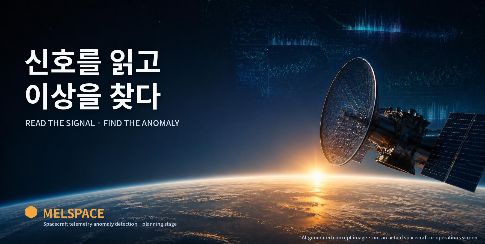

AI 생성 콘셉트 이미지입니다. 실제 위성, NASA 자료 사진, 운용 화면이 아닙니다.

# MelSpace

위성과 우주 탐사선은 온도, 전력 같은 상태를 숫자로 계속 기록해 지상으로 보냅니다. MelSpace는 NASA가 공개한 이런 센서 기록에서 **평소와 다른 구간을 찾아보는 학습형 프로젝트**입니다. 간단한 방법부터 시작해, 찾아낸 구간이 실제로 표시된 이상 구간과 얼마나 맞는지 같은 기준으로 비교합니다.

> **현재 상태: 기획 단계**
> 아직 탐지 코드, 내려받은 데이터, 실험 결과가 없습니다. 지금 저장소에는 계획 문서만 있습니다.
> **다음 과제:** 센서 채널 하나를 불러와 그래프로 확인하기

## 어떻게 진행하나요

**기록 읽기 → 그래프로 확인 → 이상 후보 찾기 → 정답 표시와 비교**

1. **기록 읽기** — 공개 데이터에서 센서 채널 하나를 불러옵니다.
2. **그래프로 확인** — 시간 순서대로 값을 그려 보고, 이상으로 표시된 구간을 색으로 칠합니다.
3. **이상 후보 찾기** — 평소 범위를 먼저 정해 두고, 그 범위를 벗어난 구간을 후보로 표시합니다.
4. **정답 표시와 비교** — 후보가 실제 이상 구간을 얼마나 잡았는지, 엉뚱한 곳을 얼마나 짚었는지, 얼마나 늦게 잡았는지 셉니다.

여기서 "이상 후보"는 **평소와 달라 보인다는 표시일 뿐**, 고장이 났다는 확정이나 원인 진단이 아닙니다.

## 이 프로젝트가 아닌 것

- 실제 우주선을 제어하거나, 고장 원인을 진단하거나, 실시간으로 감시하는 시스템이 아닙니다. 공개 데이터로 컴퓨터에서 실험만 합니다.
- 데이터의 채널 이름과 시간은 익명 처리돼 있습니다. 그래서 어떤 센서인지, 단위가 무엇인지, 언제 기록됐는지 **붙이지 않고** "몇 번째 값"으로만 다룹니다.
- 원본 데이터는 이 저장소에 올리지 않습니다(재배포 허용 여부를 확인하지 못했기 때문). 받는 방법만 안내합니다.

## 왜 만드나요

앞선 프로젝트들에서 해 온 **데이터 검증, 같은 조건에서의 실험 비교, 결과의 근거 남기기**를 처음 다루는 우주 센서 데이터에 적용해 보려는 것입니다. 그리고 AI의 도움을 받되, **핵심 코드는 직접 작성하면서** 코드가 어떻게 작동하는지 이해하는 것이 목표입니다. 작은 기능 하나마다 결과를 먼저 예상하고, 실행한 뒤 예상과 비교해 기록합니다.

## 자세히 보기

| 문서 | 내용 |
|---|---|
| [데이터 · 이용 조건 · 출처](./docs/DATA.md) | 데이터 구성, 이미 적용된 전처리와 그 한계, 이용 조건, 원 연구 결과(참고용), 출처 |
| [평가 기준 · 데이터 분할](./docs/EVALUATION.md) | 포착·오경보·놓침·탐지 지연 계산법, 원 코드와의 차이, 데이터 나누는 규칙 |
| [범위 · 개발 순서 · 첫 과제](./docs/DEVELOPMENT.md) | 비교 범위와 1~3단계 계획, 단계별 할 일, 다음 세션 첫 과제, 저장소 구성 |
| [기획 근거](./docs/PLANNING.md) | 확인한 자료와 확인하지 못한 자료, 첫 버전 범위 |
| [재사용 계획](./docs/REUSE_ADAPTATION.md) | 기존 프로젝트에서 가져올 코드와 바꿀 점 |
| [학습 기록](./docs/LEARNING_LOG.md) | `예상 / 변경 / 실제 결과 / 알게 된 점` (첫 구현 세션부터) |
| [작업·검토 규칙](./AGENTS.md) | 사람과 AI 에이전트의 역할, 리뷰 규칙 |

## 라이선스

미정. 데이터는 이 저장소의 라이선스 대상이 아닙니다([이용 조건](./docs/DATA.md#2-이용-조건-데이터와-코드는-따로)).
